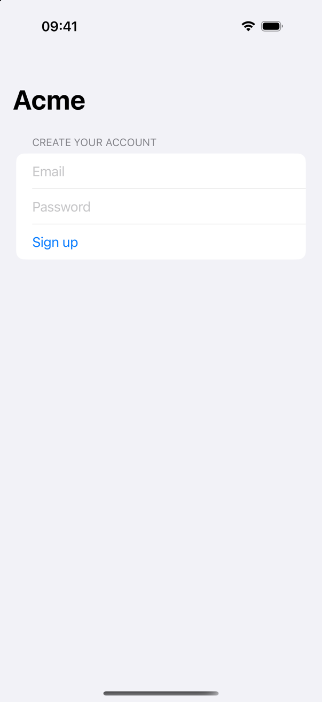
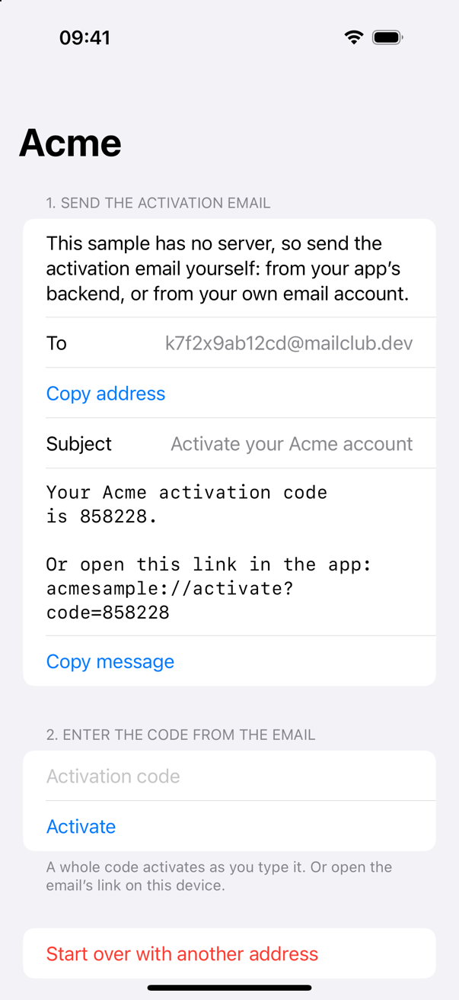
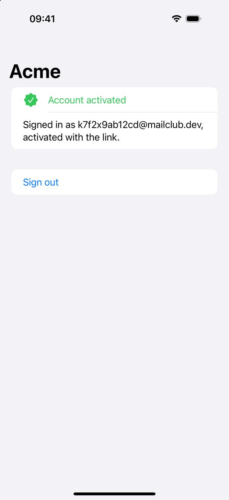

# Proxy Mail QA iOS sample

A small SwiftUI app, Acme, whose sign-up needs email activation. Use it to try
[Proxy Mail QA](https://proxymail.qa) with an iOS app, by hand or with a coding
agent that drives the iOS Simulator.

The sample has no server and needs no keys. When you sign up, it makes up an
activation code and shows you the email to send. You send that email to your
Proxy Mail QA test address, from your app's backend or from your own email
account. Then you get the code or link back from Proxy Mail QA, and activate.

<p>
  
  
  
</p>

## What you need

- A Mac with Xcode 16 or later, and an iOS 17 or later simulator.
- A Proxy Mail QA account. The Free plan is enough: https://app.proxymail.qa
- An email account to send the activation email from. Your own is fine.

## Try it with a coding agent

Claude Code Desktop can run the app in the iOS Simulator next to the
conversation, and tap and type in it
([Anthropic's guide](https://code.claude.com/docs/en/desktop-ios-simulator)).
First connect Proxy Mail QA to Claude Code, with the
[one-prompt setup](https://proxymail.qa/docs/api#agent-setup) or the
[plugin](https://github.com/aaquib90/proxymail-qa-plugin).

Open this folder in a Claude Code Desktop session and ask:

> Build AcmeSample and run it in the simulator. Sign up with a new Proxy Mail
> QA test address and the password it gives you. When the app shows the
> activation email, tell me the address and wait while I send it. Then get the
> code from Proxy Mail QA, not from the screen, enter it, and check the app says
> the account is activated.

The agent builds and launches the app, creates the address with
`create_address`, and signs up. It then asks you to send the email: tap
**Copy message** in the app, paste it into a new email to the address, and
send it. (The Simulator shares its clipboard with your Mac.) The agent gets
the code with `wait_for_code` and types it in; the app activates as soon as
the whole code is in.

To activate with the link instead, end the prompt with "then open the
activation link from the email in the app". `wait_for_link` returns
`acmesample://activate?code=…`, the agent opens it on the simulator, and taps
**Open** when iOS asks "Open in 'Acme'?".

The code is on the screen only because the sample has no server to keep it
secret; a real app's code is only in the email. Asking the agent to take it
from Proxy Mail QA tests the same path your own app will.

## Try it by hand

1. Open `AcmeSample.xcodeproj` in Xcode and run it on a simulator.
2. In [Proxy Mail QA](https://app.proxymail.qa), create a test address with
   **New address**.
3. In the app, sign up with that address and any password of 8 or more
   characters.
4. Send the email the app shows to the address, from your own email account.
5. In Proxy Mail QA, the address's **Activation** column shows the code within
   seconds. Enter it in the app. Or open the link on the simulator:

   ```bash
   xcrun simctl openurl booted 'acmesample://activate?code=123456'
   ```

## How it's built

- `AcmeSample/Account.swift` is the whole "backend": one account kept on the
  device, a made-up activation code, and the checks for the code and the link.
- `AcmeSample/AcmeSampleApp.swift` is the screens. Every field and button has an
  accessibility identifier (`email`, `password`, `signUp`, `address`,
  `message`, `code`, `activate`, `status`, `problem`, `signOut`, `logIn`) for
  UI tests.
- `AcmeSample/Info.plist` registers the `acmesample://` scheme.

## With your own app

Your app's server sends its own activation emails, so there's nothing to send
by hand: the agent or test signs up and waits for the code or link. See
[iOS apps with a coding agent](https://proxymail.qa/docs/ios-agents),
[XCUITest](https://proxymail.qa/docs/xcuitest) and
[Maestro](https://proxymail.qa/docs/maestro).

## License

MIT
